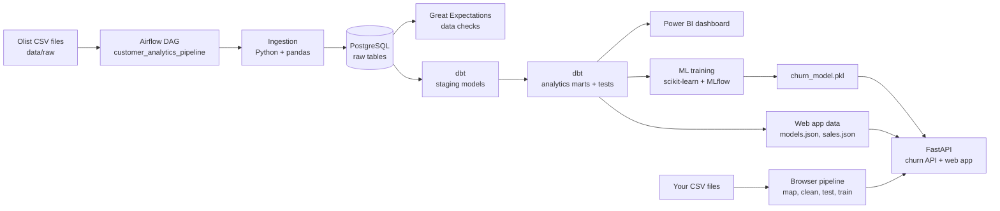

# Customer Analytics Platform


An end-to-end data analytics and machine learning platform built on real e-commerce data. It loads raw orders into a database, cleans and models them with dbt, reports on them in Power BI, and predicts which customers are likely to stop buying (churn).

The same journey runs as an interactive web app: ingestion, data quality, transformation, customer insights, training, evaluation, prediction and a sales dashboard. It starts on the Olist example data, and anyone can remove it and upload their own sales files to run the whole flow on them.

**Live app:** https://api-lemon-ten-86.vercel.app

## Business problem

An online marketplace wants to know:

- Which customers bring the most value?
- Which products drive revenue?
- Which customers are at risk of leaving?

This project builds the full pipeline that answers those questions, from raw CSV files to a live prediction.

## Web app

A single-page app served by FastAPI (`api/app/static/index.html`), organised as one page per pipeline stage. Every page has something to do, not just something to read.

| Page | What you can do |
|---|---|
| Overview | Run the full pipeline and watch each module turn healthy; KPIs and the data source |
| Ingestion | Load the example files, or remove them and upload your own CSV files (button or drag and drop); view each table's columns, detected types and empty values |
| Data quality | Run checks for empty values, duplicate rows, repeated keys, dates stored as text and negative amounts; open a check to see its query |
| Transformation | Map your columns, trigger the pipeline (ingest, transform, test), compare raw rows with cleaned orders and the customer table, read each rule and the test results |
| Customer insights | Change the churn window and watch churn recompute; recency histogram, orders per customer, customer search |
| Training | Choose features and the train/test split, train a Random Forest, compare runs; adding `recency` shows data leakage |
| Evaluation | Pick a run, switch between holdout and in-sample scores, move the decision threshold; confusion matrix, ROC curve, baseline, feature importance |
| Prediction | Score one customer with what-if changes, or batch-score real customers; each gets a recommended action |
| Dashboard | Filter by period, date range, region and metric; drag to zoom; daily, weekly or monthly; revenue by region and category |
| Summary | The same approach applied to student dropout |

### Use your own data

On **Ingestion**, select **Remove all**, then **Upload files**. CSV, TSV and TXT files are supported; several related files can be uploaded together.

On **Transformation**, the field mapping is detected automatically and can be changed:

| Field | Required | Notes |
|---|---|---|
| Order date | yes | ISO dates, `DD/MM/YYYY` or `MM/DD/YYYY` (detected, or set the date format) |
| Amount | yes | Line total or unit price; currency symbols and thousands separators are handled |
| Quantity | no | Used only when the amount is a unit price, so revenue = unit price × quantity |
| Customer | yes | The ID that identifies a person |
| Order ID | no | Lines with the same ID form one order; without it every row is an order |
| Status | no | Choose which statuses to keep, for example to drop refunds |
| Category, Region | no | Power the dashboard breakdowns and the region filter |

Fields can come from different files: tables are linked through columns with the same name, the way the dbt models join on keys. **Trigger DAG** then joins, cleans and aggregates the data into orders and a customer table (recency, frequency, monetary value, lifetime), runs 8 tests on the result, and trains a baseline Random Forest. All pages then use your data.

Uploaded files are processed in the browser and are never sent to the server. They are not saved either, so reloading the page returns to the example.

Tested end to end with four datasets:

| Dataset | Shape | Result |
|---|---|---|
| Olist (example, uploaded) | 5 related tables, 344,554 rows | R$ 13.59M from 98,666 orders and 95,420 customers; holdout ROC-AUC 0.635 |
| Superstore | 1 table, `MM/DD/YYYY` dates, line totals | 2.30M from 5,009 orders and 793 customers; ROC-AUC 0.761 |
| UCI Online Retail | 541,909 rows, unit price and quantity, cancellations, missing customers | 8.30M from 22,190 invoices and 4,372 customers; ROC-AUC 0.777 |
| Synthetic shop sales | `DD/MM/YYYY` dates, `$1,234.50` amounts, refunds | Refunds filtered by status; all tests pass |

The revenue and order figures match the same calculation in pandas.

### Models in the app

- **Example data:** the Training and Evaluation pages read `api/app/static/models.json`, which holds 93 real scikit-learn runs (every feature combination and three splits) built by `ml/src/build_web_runs.py`. Prediction calls the deployed `/predict` API.
- **Uploaded data:** a Random Forest (40 trees, balanced classes, Gini splits) is trained in the browser on the customer table. On the uploaded Olist files it reaches a holdout ROC-AUC of 0.635, against 0.648 for scikit-learn on the same data. Prediction and batch scoring use this browser model.

### Dashboard data

For the example, `api/app/static/sales.json` holds daily revenue and orders, per-state series and monthly category revenue, rebuilt from the Olist files the same way as `mart_daily_sales` by `ml/src/build_web_sales.py`. For uploaded data the same structure is built in the browser.

## Architecture



| Stage | Tool | What it does |
|---|---|---|
| Ingestion | Python, pandas | Loads every CSV in `data/raw/` into PostgreSQL |
| Orchestration | Apache Airflow | Runs ingestion, `dbt run` and `dbt test` in order, daily |
| Storage | PostgreSQL 16 | Holds raw tables and dbt models |
| Data quality | Great Expectations, dbt tests | Checks row counts, nulls and uniqueness |
| Transformation | dbt | Builds staging models and business marts |
| Analytics | Power BI, Jupyter | Dashboards and exploratory analysis |
| Machine learning | scikit-learn, MLflow | Trains and tracks the churn model |
| Serving | FastAPI | `/predict` endpoint and the interactive web app |
| Web app | HTML, CSS, JavaScript, PapaParse | Pipeline pages, browser-side processing of uploaded data, in-browser Random Forest |
| Delivery | Docker, GitHub Actions, Vercel | Local stack, CI checks, hosted API |

## Project structure

```
.
├── airflow/dags/customer_pipeline.py   # Airflow DAG: ingestion >> dbt run >> dbt test
├── src/
│   ├── database.py                     # PostgreSQL connection from env vars
│   ├── ingestion.py                    # CSV -> PostgreSQL loader
│   └── validation/validate_orders.py   # Great Expectations checks on orders
├── great expectations/                 # Great Expectations config and suites
├── customer_analytics_dbt/
│   ├── models/staging/                 # stg_orders, stg_customers, stg_order_items, stg_products, stg_reviews
│   ├── models/marts/                   # fact_orders and analytics marts
│   └── models/schema.yml               # sources, docs and tests
├── analysis/sales_analysis.ipynb       # exploratory sales analysis
├── ml/
│   ├── src/features.py                 # exports mart_customer_rfm to a training CSV
│   ├── src/create_churn_dataset.py     # alternative, forward-looking churn label
│   ├── src/train.py                    # trains the model and logs it to MLflow
│   ├── src/evaluate.py                 # metrics, confusion matrix, ROC curve
│   ├── src/build_web_runs.py           # precomputes the example runs for the web app
│   ├── src/build_web_sales.py          # rebuilds daily sales for the web dashboard
│   ├── data/training/customer_churn.csv
│   └── models/churn_model.pkl
├── api/
│   ├── app/main.py                     # FastAPI app, static files and API routes
│   ├── app/model.py                    # loads the model and predicts
│   ├── app/schemas.py                  # request validation
│   ├── app/static/index.html           # the web app
│   ├── app/static/models.json          # example model runs (Training, Evaluation)
│   ├── app/static/sales.json           # example daily sales (Dashboard)
│   └── models/churn_model.pkl          # copy bundled for the Vercel deployment
├── dashboard/                          # Power BI file and screenshots
├── tests/                              # pytest
├── docker-compose.yml                  # postgres, airflow, api
└── Dockerfile                          # Airflow image with dbt-postgres
```

## Data

The project uses the [Brazilian E-Commerce Public Dataset by Olist](https://www.kaggle.com/datasets/olistbr/brazilian-ecommerce): about 99,000 orders from 2016 to 2018. Amounts are in Brazilian reais (R$).

The dataset is not included in this repository. Download it from Kaggle and extract the CSV files into `data/raw/`:

```
data/raw/
├── olist_customers_dataset.csv
├── olist_geolocation_dataset.csv
├── olist_order_items_dataset.csv
├── olist_order_payments_dataset.csv
├── olist_order_reviews_dataset.csv
├── olist_orders_dataset.csv
├── olist_products_dataset.csv
├── olist_sellers_dataset.csv
└── product_category_name_translation.csv
```

Each file becomes a table of the same name in PostgreSQL.

## Data models (dbt)

**Staging** models clean and type the raw tables, one model per source table.

**Marts** are business-ready tables in the `public_analytics` schema:

| Model | Grain | Purpose |
|---|---|---|
| `fact_orders` | order | Orders joined with customer location |
| `mart_daily_sales` | day | Orders and revenue per day |
| `mart_sales_summary` | whole business | Total orders, customers, revenue and average order value |
| `mart_product_performance` | product | Orders, revenue, average price and review score |
| `mart_customer_segments` | customer | Rule-based segments: VIP, Loyal, Regular, New |
| `mart_customer_rfm` | customer | Recency, frequency, monetary value, lifetime and churn label |

Tests in `models/schema.yml` check that keys are unique and not null, and that revenue fields are filled.

## Dashboard

The web app has an interactive sales dashboard (see [Web app](#web-app)). The original Power BI report is below.

### Executive overview


### Products


The Power BI file is `dashboard/customer_analytics_dashboard.pbix`.

## Churn model

**Label.** In `mart_customer_rfm`, the snapshot date is 2018-06-01. A customer counts as churned if their last delivered order was more than 120 days before that date.

**Features.** `frequency`, `monetary`, `avg_order_value`, `customer_lifetime_days`. Recency is left out because the label is built from it.

**Model.** Random Forest (200 trees, balanced class weights), trained on an 80/20 split. Parameters, accuracy, ROC-AUC and the model itself are logged to MLflow under the `customer_churn_prediction` experiment. The reported test ROC-AUC is about 0.67.

The model bundled with the API (`api/models/churn_model.pkl`) is older than `train.py`: it takes `frequency`, `monetary`, `recency` and `avg_order_value`, so because recency defines the label it mostly reproduces the 120-day rule. The web app shows this as an example of leakage. To serve the leakage-free model, retrain with `train.py` and change the features sent in `api/app/main.py`.

`ml/src/create_churn_dataset.py` builds an alternative label: a repeat customer churns if they place no order in the 180 days after the snapshot. This looks forward in time, so it avoids building the label from the features.

## API and web app

| Method | Path | Description |
|---|---|---|
| `GET` | `/` | The web app |
| `GET` | `/static/{file}` | Web app data (`models.json`, `sales.json`) |
| `POST` | `/predict` | Churn prediction for one customer |
| `GET` | `/health` | Service status |
| `GET` | `/api/metrics` | Headline business figures, honest holdout ROC-AUC and the data source |
| `GET` | `/docs` | Interactive Swagger docs |

Example request:

```bash
curl -X POST http://localhost:8000/predict \
  -H "Content-Type: application/json" \
  -d '{"frequency": 2, "monetary": 200, "recency": 30, "avg_order_value": 100}'
```

Example response:

```json
{ "prediction": 0, "churn_prediction": 0, "probability": 0.31 }
```

## How to run

### Prerequisites

- Docker Desktop with Docker Compose
- The Olist CSV files in `data/raw/` (see [Data](#data))

### 1. Clone

```bash
git clone https://github.com/askmadhavan/Customer-Analytics-Platform.git
cd Customer-Analytics-Platform
```

### 2. Start the stack

```bash
docker compose up --build -d
```

| Service | URL | Description |
|---|---|---|
| PostgreSQL | `localhost:5434` | Database (user and password `postgres`, database `customer_analytics`) |
| Airflow | http://localhost:8080 | Orchestration. The login is printed in the container logs: `docker compose logs airflow` |
| API | http://localhost:8000 | Churn API and web app |

The credentials are local development defaults. Change them before running this anywhere else.

### 3. Run the pipeline

In Airflow, trigger the `customer_analytics_pipeline` DAG. It runs:

```
data_ingestion  ->  dbt_transform  ->  dbt_test
```

This loads the CSV files, builds all dbt models and runs the dbt tests.

### 4. Train the model (optional)

The repository already includes a trained model. To retrain it:

```bash
# Export the training data from the dbt mart (runs inside the Airflow container)
docker compose exec -w /opt/airflow airflow python ml/src/features.py

# Train and evaluate on your machine, from the repository root
pip install pandas scikit-learn mlflow joblib matplotlib
python ml/src/train.py
python ml/src/evaluate.py

# Browse the runs
mlflow ui
```

To ship a new model with the hosted API, copy `ml/models/churn_model.pkl` to `api/models/churn_model.pkl`.

### 5. Run only the web app

The web app needs no database or Airflow:

```bash
cd api
pip install -r requirements.txt
uvicorn app.main:app --reload
```

Open http://localhost:8000. To rebuild its example data, run from the repository root:

```bash
python ml/src/build_web_runs.py              # api/app/static/models.json (about a minute)
python ml/src/build_web_sales.py data/raw    # api/app/static/sales.json
```

The presenter notes for the workshop appear when `?notes` is added to the address.

### 6. Run the tests

```bash
pip install -r requirements.txt
PYTHONPATH=. pytest
flake8 api src tests
```

## CI and deployment

- **GitHub Actions** (`.github/workflows/ci.yml`) runs pytest and flake8 and builds the API Docker image on every push and pull request.
- **Vercel** deploys the `api/` folder as a Python function, using the bundled model in `api/models/` and the web app in `api/app/static/`.

## Credits

The original data pipeline, dbt models, ML pipeline and dashboard were built by [Shokoufeh Yazdanian](https://github.com/shokoufehyazdanian). The interactive web app, the bring-your-own-data pipeline and the Vercel deployment were added by [Madhavan](https://www.linkedin.com/in/askmadhavan/).

Data: [Olist Brazilian E-Commerce Public Dataset](https://www.kaggle.com/datasets/olistbr/brazilian-ecommerce) on Kaggle. Also tested with the [UCI Online Retail dataset](https://archive.ics.uci.edu/dataset/352/online+retail) and the Tableau Superstore sample.
