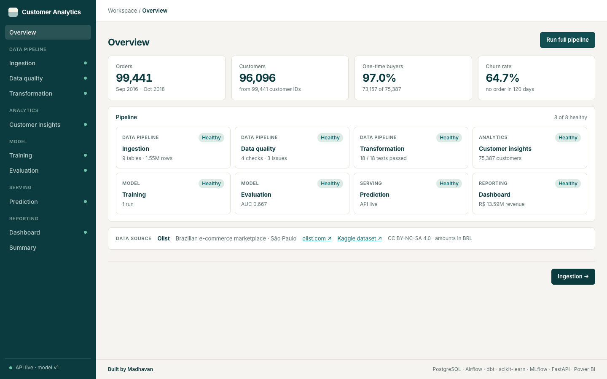
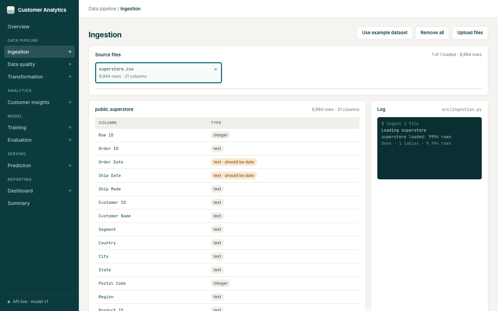
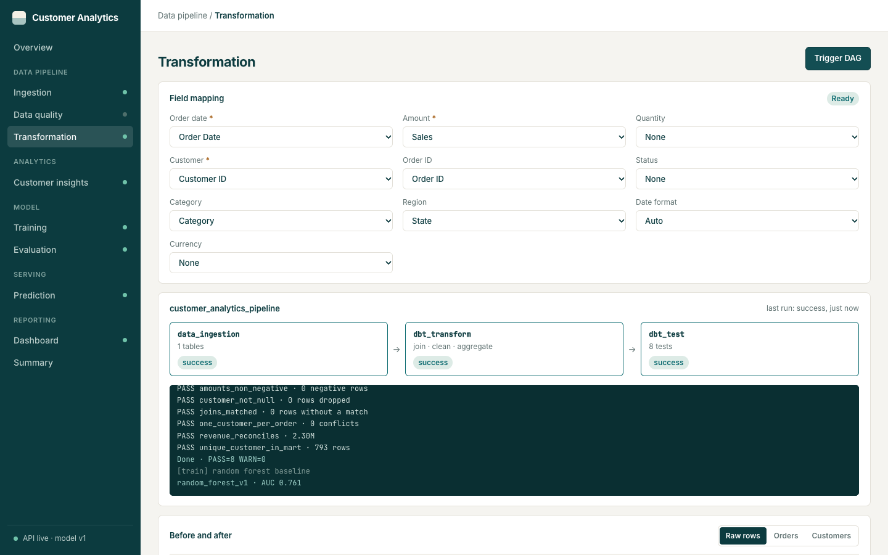
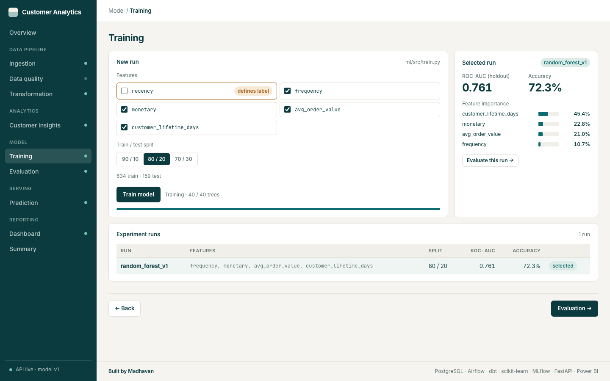
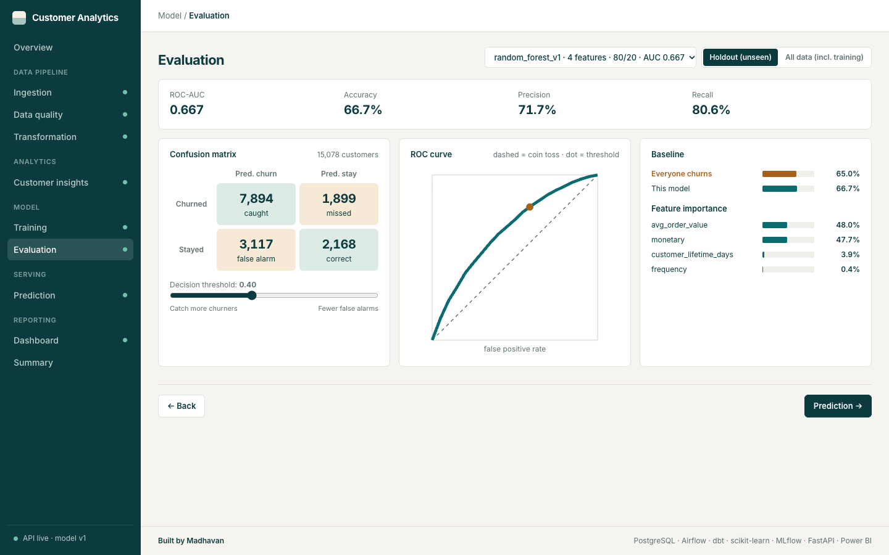
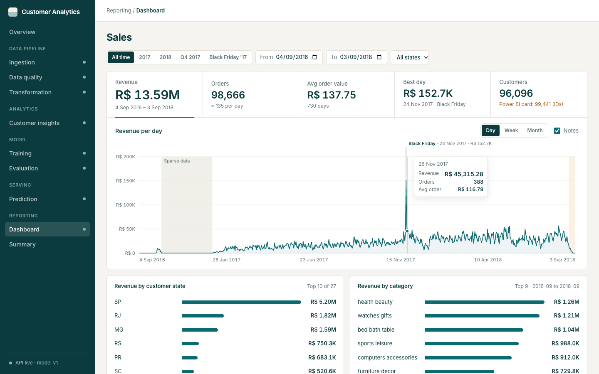
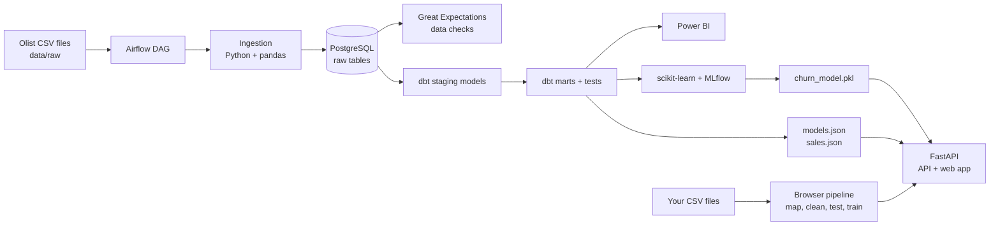

# Customer Analytics Platform

**An open-source, end-to-end customer analytics and churn prediction platform: from raw sales files to data quality checks, transformation, a churn model and an interactive dashboard. Bring your own data or start with the example.**

[](https://github.com/askmadhavan/Customer-Analytics-Platform/actions/workflows/ci.yml)
[](LICENSE)
[](https://api-lemon-ten-86.vercel.app)


**[Live demo](https://api-lemon-ten-86.vercel.app)** · [Quick start](#quick-start) · [Use your own data](#use-your-own-data) · [Contributing](CONTRIBUTING.md)



## Table of contents

- [About](#about)
- [Features](#features)
- [Screenshots](#screenshots)
- [Quick start](#quick-start)
- [Use your own data](#use-your-own-data)
- [How it works](#how-it-works)
- [API](#api)
- [Project structure](#project-structure)
- [Development](#development)
- [Known limitations](#known-limitations)
- [Contributing](#contributing)
- [License](#license)
- [Acknowledgements](#acknowledgements)

## About

Businesses lose customers quietly: they stop buying without saying why. This project answers three questions from ordinary sales data:

- Which customers bring the most value?
- Which products and regions drive revenue?
- Which customers are likely to leave, and what should we do about it?

It comes in two parts that share one design:

1. **A production-style data pipeline**: Python ingestion into PostgreSQL, orchestrated by Apache Airflow, transformed and tested with dbt, a scikit-learn churn model tracked in MLflow, a FastAPI service and a Power BI report.
2. **An interactive web app** that walks through the same lifecycle, one page per stage. It runs on the [Olist](https://www.kaggle.com/datasets/olistbr/brazilian-ecommerce) example out of the box, and anyone can remove the example and upload their own sales files. Uploaded data is processed entirely in the browser.

It was built for teaching data engineering and machine learning, and works as a template for real customer analytics.

## Features

- **Bring your own data**: upload CSV files, including several related tables, and the field mapping is detected automatically
- **Data quality checks**: empty values, duplicate rows, repeated keys, dates stored as text, negative amounts
- **Transformation pipeline**: joins tables on shared keys, parses dates and amounts, filters by status, aggregates to orders and a customer table, then runs 8 tests on the result
- **Customer insights**: recency, frequency and monetary value; change the churn window and watch churn recompute
- **Churn model**: train a Random Forest on chosen features and splits, compare runs, and see data leakage when the label leaks into the features
- **Honest evaluation**: holdout against in-sample scores, a decision-threshold slider, confusion matrix, ROC curve, baseline and feature importance
- **Prediction**: score one customer with what-if changes or batch-score real customers, each with a recommended action
- **Interactive dashboard**: period presets, date range, drag to zoom, day, week or month, region filter, revenue by region and category
- **Privacy by design**: uploaded files never leave the browser

## Screenshots

| Upload your data | Map fields and run the pipeline |
|---|---|
|  |  |

| Train and compare runs | Evaluate honestly |
|---|---|
|  |  |



## Quick start

### Try it online

Open **https://api-lemon-ten-86.vercel.app**, select **Run full pipeline**, then explore the pages. To use your own data, go to **Ingestion**, select **Remove all** and **Upload files**.

### Run the web app locally

Needs Python 3.12 or later. No database is required.

```bash
git clone https://github.com/askmadhavan/Customer-Analytics-Platform.git
cd Customer-Analytics-Platform/api
pip install -r requirements.txt
uvicorn app.main:app --reload
```

Open http://localhost:8000.

### Run the full data stack

Needs Docker Desktop with Docker Compose, and the Olist CSV files in `data/raw/` (see [Example data](#example-data)).

```bash
docker compose up --build -d
```

| Service | URL | Notes |
|---|---|---|
| PostgreSQL | `localhost:5434` | User and password `postgres`, database `customer_analytics` |
| Airflow | http://localhost:8080 | The login is printed in `docker compose logs airflow` |
| API and web app | http://localhost:8000 | |

The credentials are local development defaults. Change them before running this anywhere else.

In Airflow, trigger the `customer_analytics_pipeline` DAG. It runs `data_ingestion -> dbt_transform -> dbt_test`: it loads the CSV files, builds all dbt models and runs the dbt tests.

## Use your own data

1. On **Ingestion**, select **Remove all**, then **Upload files** or drag files onto the page. CSV, TSV and TXT files are supported; upload related files together.
2. On **Data quality**, select **Run all checks**.
3. On **Transformation**, review the field mapping, then select **Run pipeline**.
4. Every other page now uses your data.

| Field | Required | Notes |
|---|---|---|
| Order date | Yes | ISO dates, `DD/MM/YYYY` or `MM/DD/YYYY`, detected or set by hand |
| Amount | Yes | Line total or unit price; currency symbols and thousands separators are handled |
| Quantity | No | Used only when the amount is a unit price: revenue = unit price × quantity |
| Customer | Yes | The ID that identifies a person |
| Order ID | No | Lines with the same ID form one order; without it, every row is an order |
| Status | No | Choose which statuses to keep, for example to drop refunds |
| Category, Region | No | Power the dashboard breakdowns and the region filter |

Fields can come from different files. Tables are linked through columns with the same name, the way the dbt models join on keys.

### Tested datasets

| Dataset | Shape | Result |
|---|---|---|
| [Olist](https://www.kaggle.com/datasets/olistbr/brazilian-ecommerce), uploaded | 5 related tables, 344,554 rows | R$ 13.59M from 98,666 orders and 95,420 customers; holdout ROC-AUC 0.635 |
| Tableau Superstore | 1 table, `MM/DD/YYYY` dates, line totals | 2.30M from 5,009 orders and 793 customers; ROC-AUC 0.761 |
| [UCI Online Retail](https://archive.ics.uci.edu/dataset/352/online+retail) | 541,909 rows, unit price and quantity, cancellations, missing customers | 8.30M from 22,190 invoices and 4,372 customers; ROC-AUC 0.777 |
| Synthetic shop sales | `DD/MM/YYYY` dates, `$1,234.50` amounts, refunds | Refunds filtered by status; all tests pass |

Revenue and order counts match the same calculation in pandas.

## How it works

### Architecture



| Stage | Tool | What it does |
|---|---|---|
| Ingestion | Python, pandas | Loads every CSV in `data/raw/` into PostgreSQL |
| Orchestration | Apache Airflow | Runs ingestion, `dbt run` and `dbt test` in order, daily |
| Storage | PostgreSQL 16 | Holds raw tables and dbt models |
| Data quality | Great Expectations, dbt tests | Checks row counts, nulls and uniqueness |
| Transformation | dbt | Builds staging models and business marts |
| Machine learning | scikit-learn, MLflow | Trains and tracks the churn model |
| Serving | FastAPI | `/predict` and the web app |
| Web app | HTML, CSS, JavaScript, PapaParse | Pipeline pages, browser-side processing, in-browser Random Forest |
| Reporting | Power BI, Jupyter | Executive report and exploratory analysis |
| Delivery | Docker, GitHub Actions, Vercel | Local stack, CI, hosting |

### Example data

The [Brazilian E-Commerce Public Dataset by Olist](https://www.kaggle.com/datasets/olistbr/brazilian-ecommerce): about 99,000 orders from 2016 to 2018, in Brazilian reais (R$). It is not included in the repository. Download it from Kaggle and extract the nine CSV files into `data/raw/`. Each file becomes a table of the same name in PostgreSQL.

### Data models (dbt)

Staging models clean and type the raw tables. Marts in the `public_analytics` schema are ready for reporting and modelling:

| Model | Grain | Purpose |
|---|---|---|
| `fact_orders` | Order | Orders joined with customer location |
| `mart_daily_sales` | Day | Orders and revenue per day |
| `mart_sales_summary` | Business | Total orders, customers, revenue, average order value |
| `mart_product_performance` | Product | Orders, revenue, average price, review score |
| `mart_customer_segments` | Customer | Rule-based segments: VIP, Loyal, Regular, New |
| `mart_customer_rfm` | Customer | Recency, frequency, monetary value, lifetime, churn label |

Tests in `models/schema.yml` check that keys are unique and not null, and that revenue fields are filled.

### Churn model

- **Label.** A customer has churned if they have not ordered in the 120 days before the snapshot date (2018-06-01 for the example; the day after the last order for uploaded data).
- **Features.** `frequency`, `monetary`, `avg_order_value` and `customer_lifetime_days`. `recency` is left out by default because the label is built from it; adding it shows leakage, with an AUC of 1.0.
- **Pipeline model.** `ml/src/train.py` trains a Random Forest (200 trees, balanced classes) on an 80/20 split and logs it to MLflow. Holdout ROC-AUC on the example is about 0.67.
- **Web app, example data.** The Training and Evaluation pages read 93 real scikit-learn runs from `api/app/static/models.json`. Prediction calls the `/predict` API.
- **Web app, uploaded data.** A Random Forest (40 trees, balanced classes, Gini splits) is trained in the browser. On the uploaded Olist files it reaches a holdout ROC-AUC of 0.635, against 0.648 for scikit-learn on the same data.

`ml/src/create_churn_dataset.py` builds an alternative, forward-looking label: a repeat customer churns if they place no order in the 180 days after the snapshot.

## API

| Method | Path | Description |
|---|---|---|
| `GET` | `/` | The web app |
| `GET` | `/static/{file}` | Web app data (`models.json`, `sales.json`) |
| `POST` | `/predict` | Churn prediction for one customer |
| `GET` | `/health` | Service status |
| `GET` | `/api/metrics` | Headline figures, holdout ROC-AUC and data source |
| `GET` | `/docs` | Interactive API documentation |

```bash
curl -X POST http://localhost:8000/predict \
  -H "Content-Type: application/json" \
  -d '{"frequency": 2, "monetary": 200, "recency": 30, "avg_order_value": 100}'
```

```json
{ "prediction": 0, "churn_prediction": 0, "probability": 0.31 }
```

## Project structure

```
.
├── airflow/dags/customer_pipeline.py   # Airflow DAG: ingestion >> dbt run >> dbt test
├── src/                                # ingestion, database connection, Great Expectations checks
├── great expectations/                 # Great Expectations config and suites
├── customer_analytics_dbt/             # dbt staging models, marts and tests
├── analysis/sales_analysis.ipynb       # exploratory analysis
├── ml/
│   ├── src/train.py                    # trains the model and logs it to MLflow
│   ├── src/evaluate.py                 # metrics, confusion matrix, ROC curve
│   ├── src/features.py                 # exports mart_customer_rfm to a training CSV
│   ├── src/create_churn_dataset.py     # alternative, forward-looking churn label
│   ├── src/build_web_runs.py           # builds the web app's example model runs
│   ├── src/build_web_sales.py          # builds the web app's example daily sales
│   └── data/training/customer_churn.csv
├── api/
│   ├── app/main.py                     # FastAPI app and routes
│   ├── app/model.py                    # loads the model and predicts
│   ├── app/static/index.html           # the web app
│   ├── app/static/models.json          # example model runs
│   ├── app/static/sales.json           # example daily sales
│   └── models/churn_model.pkl          # model served by /predict
├── dashboard/                          # Power BI report and screenshots
├── docs/images/                        # README screenshots
├── tests/                              # pytest
├── docker-compose.yml                  # postgres, airflow, api
└── Dockerfile                          # Airflow image with dbt-postgres
```

## Development

Run the tests and the linter:

```bash
pip install -r requirements.txt
PYTHONPATH=. pytest
flake8 api src tests
```

Retrain the pipeline model (after the Airflow DAG has run):

```bash
docker compose exec -w /opt/airflow airflow python ml/src/features.py
pip install pandas scikit-learn mlflow joblib matplotlib
python ml/src/train.py
python ml/src/evaluate.py
mlflow ui
```

To serve a new model, copy `ml/models/churn_model.pkl` to `api/models/churn_model.pkl`.

Rebuild the web app's example data:

```bash
python ml/src/build_web_runs.py              # api/app/static/models.json, about a minute
python ml/src/build_web_sales.py data/raw    # api/app/static/sales.json
```

Workshop presenter notes appear when `?notes` is added to the web app's address.

**CI and deployment.** GitHub Actions runs pytest and flake8 and builds the API Docker image on every push and pull request. Vercel deploys the `api/` folder as a Python function.

## Known limitations

- Uploaded data lives only in the browser tab. Reloading the page returns to the example.
- Very large files (hundreds of MB) depend on the visitor's browser memory. Excel files must be saved as CSV first.
- The model served by `/predict` (`api/models/churn_model.pkl`) predates `train.py` and takes `recency` as an input, so it mostly reproduces the 120-day rule. The web app uses this as an example of leakage. Retrain with `train.py` and update the features sent in `api/app/main.py` to serve the leakage-free model.
- Churn is defined by inactivity, not a contract end, so it suits retail and marketplace data better than subscriptions.

## Contributing

Contributions are welcome: bug reports, new dataset formats, better checks, docs and tests. Read [CONTRIBUTING.md](CONTRIBUTING.md) to get started, and open an issue before large changes.

## License

Released under the [MIT License](LICENSE).

The Olist example data is published by Olist under [CC BY-NC-SA 4.0](https://www.kaggle.com/datasets/olistbr/brazilian-ecommerce), which does not allow commercial use. The UCI Online Retail dataset is licensed under CC BY 4.0. Datasets are not included in this repository; check each dataset's own license before use.

## Acknowledgements

- The original data pipeline, dbt models, ML pipeline and Power BI report were built by [Shokoufeh Yazdanian](https://github.com/shokoufehyazdanian).
- The interactive web app, the bring-your-own-data pipeline and the Vercel deployment were added by [Madhavan](https://www.linkedin.com/in/askmadhavan/).
- Data: [Olist Brazilian E-Commerce Public Dataset](https://www.kaggle.com/datasets/olistbr/brazilian-ecommerce), the [UCI Online Retail dataset](https://archive.ics.uci.edu/dataset/352/online+retail) and the Tableau Superstore sample.
- CSV parsing in the browser by [PapaParse](https://www.papaparse.com/).
