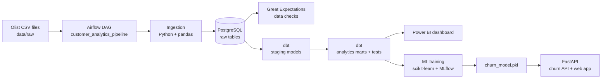

# Customer Analytics Platform


An end-to-end data analytics and machine learning platform built on real e-commerce data. It loads raw orders into a database, cleans and models them with dbt, reports on them in Power BI, and predicts which customers are likely to stop buying (churn) through a FastAPI service with a simple web app.

## Business problem

An online marketplace wants to know:

- Which customers bring the most value?
- Which products drive revenue?
- Which customers are at risk of leaving?

This project builds the full pipeline that answers those questions, from raw CSV files to a live prediction.

## Architecture



| Stage | Tool | What it does |
|---|---|---|
| Ingestion | Python, pandas | Loads every CSV in `data/raw/` into PostgreSQL |
| Orchestration | Apache Airflow | Runs ingestion, `dbt run` and `dbt test` in order, daily |
| Storage | PostgreSQL 16 | Holds raw tables and dbt models |
| Data quality | Great Expectations, dbt tests | Checks row counts, nulls and uniqueness |
| Transformation | dbt | Builds staging models and business marts |
| Analytics | Power BI, Jupyter | Dashboards and exploratory analysis |
| Machine learning | scikit-learn, MLflow | Trains and tracks the churn model |
| Serving | FastAPI | `/predict` endpoint and a guided web app |
| Delivery | Docker, GitHub Actions, Vercel | Local stack, CI checks, hosted API |

## Project structure

```
.
├── airflow/dags/customer_pipeline.py   # Airflow DAG: ingestion >> dbt run >> dbt test
├── src/
│   ├── database.py                     # PostgreSQL connection from env vars
│   ├── ingestion.py                    # CSV -> PostgreSQL loader
│   └── validation/validate_orders.py   # Great Expectations checks on orders
├── great expectations/                 # Great Expectations config and suites
├── customer_analytics_dbt/
│   ├── models/staging/                 # stg_orders, stg_customers, stg_order_items, stg_products, stg_reviews
│   ├── models/marts/                   # fact_orders and analytics marts
│   └── models/schema.yml               # sources, docs and tests
├── analysis/sales_analysis.ipynb       # exploratory sales analysis
├── ml/
│   ├── src/features.py                 # exports mart_customer_rfm to a training CSV
│   ├── src/create_churn_dataset.py     # alternative, forward-looking churn label
│   ├── src/train.py                    # trains the model and logs it to MLflow
│   ├── src/evaluate.py                 # metrics, confusion matrix, ROC curve
│   ├── data/training/customer_churn.csv
│   └── models/churn_model.pkl
├── api/
│   ├── app/main.py                     # FastAPI app and web UI
│   ├── app/model.py                    # loads the model and predicts
│   ├── app/schemas.py                  # request validation
│   └── models/churn_model.pkl          # copy bundled for the Vercel deployment
├── dashboard/                          # Power BI file and screenshots
├── tests/                              # pytest
├── docker-compose.yml                  # postgres, airflow, api
└── Dockerfile                          # Airflow image with dbt-postgres
```

## Data

The project uses the [Brazilian E-Commerce Public Dataset by Olist](https://www.kaggle.com/datasets/olistbr/brazilian-ecommerce): about 99,000 orders from 2016 to 2018. Amounts are in Brazilian reais (R$).

The dataset is not included in this repository. Download it from Kaggle and extract the CSV files into `data/raw/`:

```
data/raw/
├── olist_customers_dataset.csv
├── olist_geolocation_dataset.csv
├── olist_order_items_dataset.csv
├── olist_order_payments_dataset.csv
├── olist_order_reviews_dataset.csv
├── olist_orders_dataset.csv
├── olist_products_dataset.csv
├── olist_sellers_dataset.csv
└── product_category_name_translation.csv
```

Each file becomes a table of the same name in PostgreSQL.

## Data models (dbt)

**Staging** models clean and type the raw tables, one model per source table.

**Marts** are business-ready tables in the `public_analytics` schema:

| Model | Grain | Purpose |
|---|---|---|
| `fact_orders` | order | Orders joined with customer location |
| `mart_daily_sales` | day | Orders and revenue per day |
| `mart_sales_summary` | whole business | Total orders, customers, revenue and average order value |
| `mart_product_performance` | product | Orders, revenue, average price and review score |
| `mart_customer_segments` | customer | Rule-based segments: VIP, Loyal, Regular, New |
| `mart_customer_rfm` | customer | Recency, frequency, monetary value, lifetime and churn label |

Tests in `models/schema.yml` check that keys are unique and not null, and that revenue fields are filled.

## Dashboard

### Executive overview


### Products


The Power BI file is `dashboard/customer_analytics_dashboard.pbix`.

## Churn model

**Label.** In `mart_customer_rfm`, the snapshot date is 2018-06-01. A customer counts as churned if their last delivered order was more than 120 days before that date.

**Features.** `frequency`, `monetary`, `avg_order_value`, `customer_lifetime_days`. Recency is left out because the label is built from it.

**Model.** Random Forest (200 trees, balanced class weights), trained on an 80/20 split. Parameters, accuracy, ROC-AUC and the model itself are logged to MLflow under the `customer_churn_prediction` experiment. The reported test ROC-AUC is about 0.67.

`ml/src/create_churn_dataset.py` builds an alternative label: a repeat customer churns if they place no order in the 180 days after the snapshot. This looks forward in time, so it avoids building the label from the features.

## API and web app

| Method | Path | Description |
|---|---|---|
| `GET` | `/` | Guided web app: three questions, then a churn verdict, risk score and suggested action |
| `POST` | `/predict` | Churn prediction for one customer |
| `GET` | `/health` | Service status |
| `GET` | `/api/metrics` | Headline business figures |
| `GET` | `/docs` | Interactive Swagger docs |

Example request:

```bash
curl -X POST http://localhost:8000/predict \
  -H "Content-Type: application/json" \
  -d '{"frequency": 2, "monetary": 200, "recency": 30, "avg_order_value": 100}'
```

Example response:

```json
{ "prediction": 0, "churn_prediction": 0, "probability": 0.31 }
```

## How to run

### Prerequisites

- Docker Desktop with Docker Compose
- The Olist CSV files in `data/raw/` (see [Data](#data))

### 1. Clone

```bash
git clone https://github.com/askmadhavan/Customer-Analytics-Platform.git
cd Customer-Analytics-Platform
```

### 2. Start the stack

```bash
docker compose up --build -d
```

| Service | URL | Description |
|---|---|---|
| PostgreSQL | `localhost:5434` | Database (user and password `postgres`, database `customer_analytics`) |
| Airflow | http://localhost:8080 | Orchestration. The login is printed in the container logs: `docker compose logs airflow` |
| API | http://localhost:8000 | Churn API and web app |

The credentials are local development defaults. Change them before running this anywhere else.

### 3. Run the pipeline

In Airflow, trigger the `customer_analytics_pipeline` DAG. It runs:

```
data_ingestion  ->  dbt_transform  ->  dbt_test
```

This loads the CSV files, builds all dbt models and runs the dbt tests.

### 4. Train the model (optional)

The repository already includes a trained model. To retrain it:

```bash
# Export the training data from the dbt mart (runs inside the Airflow container)
docker compose exec -w /opt/airflow airflow python ml/src/features.py

# Train and evaluate on your machine, from the repository root
pip install pandas scikit-learn mlflow joblib matplotlib
python ml/src/train.py
python ml/src/evaluate.py

# Browse the runs
mlflow ui
```

To ship a new model with the hosted API, copy `ml/models/churn_model.pkl` to `api/models/churn_model.pkl`.

### 5. Run the tests

```bash
pip install -r requirements.txt
PYTHONPATH=. pytest
flake8 api src tests
```

## CI and deployment

- **GitHub Actions** (`.github/workflows/ci.yml`) runs pytest and flake8 and builds the API Docker image on every push and pull request.
- **Vercel** deploys the `api/` folder as a Python function, using the bundled model in `api/models/`.

## Credits

The original data pipeline, dbt models, ML pipeline and dashboard were built by [Shokoufeh Yazdanian](https://github.com/shokoufehyazdanian). The guided churn web app and the Vercel deployment were added by [Madhavan](https://www.linkedin.com/in/askmadhavan/).

Data: [Olist Brazilian E-Commerce Public Dataset](https://www.kaggle.com/datasets/olistbr/brazilian-ecommerce) on Kaggle.
